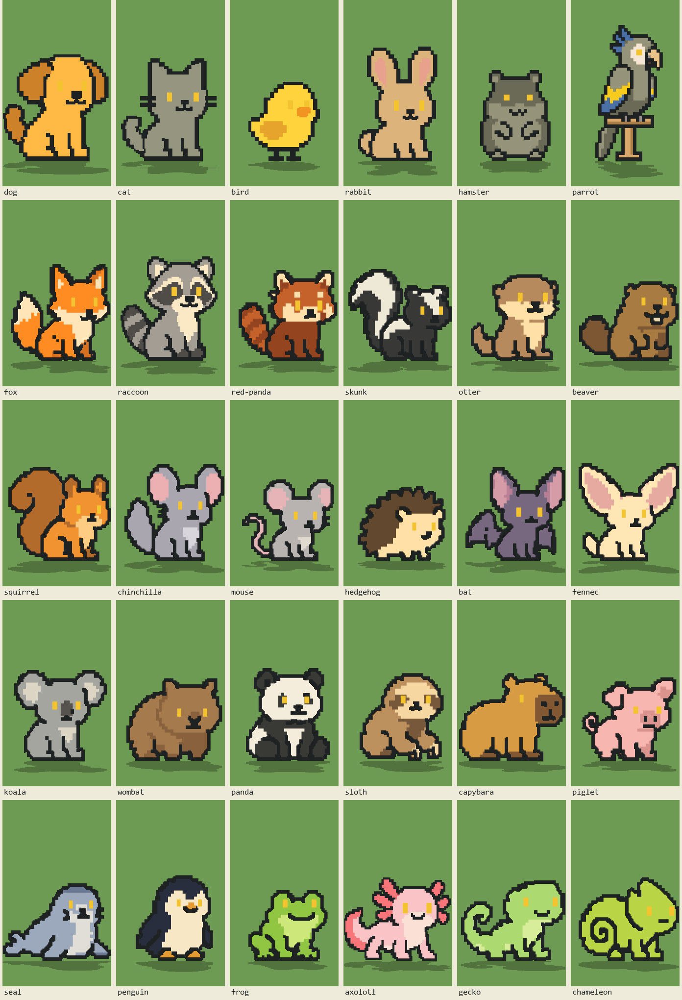
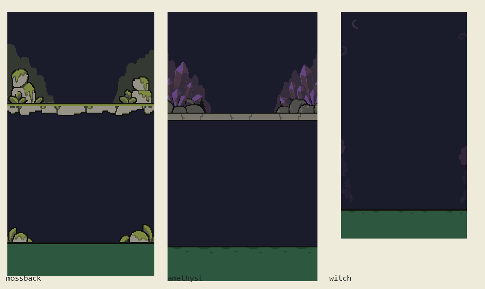

# MojiLearner SVG style reference

Studied on 2026-09-20 from the current working tree, including uncommitted artwork. This is a reference for future SVG generation, not a redesign specification. Recheck the runtime asset map when art changes.

## Visual identity

The app uses a friendly retro pixel-art world. Characters have chunky charcoal silhouettes, deliberately stepped corners, compact bodies, prominent heads, tiny faces and recognizable species features. Color is organized into broad flat regions with selective hard-edged shade or light patches. Apparent curves are stair-stepped pixels. Detail should still read when the pet is small.

Pets are more visually prominent than their environments. Home scenes have large quiet sky and ground bands. Boss arenas add finer rocks, moss, crystals or trees around the edges while retaining an open central play area. These families share a palette and hard-edged geometry, but do not share one universal pixel size.

The surrounding UI reinforces this: square panels, dark 2–4 px borders, unblurred offset shadows, white/off-white surfaces, pixel fonts, and bright accent blocks. `AppTheme` contains both older palettes and active retro colors; use the colors referenced by the relevant screen.

Core UI/world colors from [theme.dart](../lib/constants/theme.dart):

| Role | Color |
| --- | --- |
| Pet outline | `#1F2223` |
| UI outline | `#211F1F` |
| Paper / moon | `#FBF7F3` |
| Day sky | `#639BFF` |
| Meadow grass / detail | `#6ABE30` / `#4B8F1D` |
| Night sky / grass | `#1A1C2C` / `#2E573F` |
| Coral accent | `#D95763` |
| Bright yellow accent | `#FBF236` |
| Warm panel tone | `#EEC39A` |

## Pets: use the active artwork

The sheet above is a current Flutter render of all 30 pets in their natural coats. Its green swatch is the capture fixture, not each pet's assigned scene. Mouths, tails and eyes were captured during their animation cycle.

The authoritative map is `_layeredPets` in [character_sprite.dart](../lib/components/character_sprite.dart). The live dog, cat, bird, rabbit, raccoon, axolotl and penguin use `dog2_*`, `cat2_*`, `bird2_*`, `rabbit2_*`, `raccoon2_*`, `axolotl2_*`, and `penguin2_*`. Unsuffixed old artwork remains in the bundle. Although source comments describe some replacements as placeholders, they are currently active.

Visual rules:

- Build the species identity into its silhouette: cat ears and curled tail, floppy dog ears, rabbit ears, raccoon tail rings, axolotl gills, penguin belly, and so on.
- Favor seated or compact standing poses, short legs, a substantial head, and a simple front or three-quarter face. Some species use a profile pose.
- Eyes are small vertical rectangles, normally gold `#F4C430`. They have no illustrated pupils, sclera or sparkles. The app can recolor them or use heterochromia.
- Noses and mouths use very few dark cells. An open mouth is a small pocket, with muted red `#6B3439` inside where appropriate.
- Use flat coat regions and a few readable markings. Not every pet needs both a shade and a highlight; the current cat is particularly spare.
- Preserve broad areas of color. Avoid isolated decorative pixels that become visual noise at app size.

Natural palette examples from [pets.dart](../lib/constants/pets.dart):

| Pet | Coat | Selected associated tones |
| --- | --- | --- |
| Dog | `#FFB944` | Shade `#CD822A` |
| Cat | `#969680` | Simple charcoal outline |
| Bird | `#FFD33B` | Shade `#E6A42C`, beak `#F29422` |
| Rabbit | `#DCB47B` | Ear pink `#E8A18D` |
| Raccoon | `#A49D93` | Shade `#504D48`, light `#FBE8C5` |
| Axolotl | `#FAC4C6` | Light `#FBE1D5`, coral gills `#F87579` |
| Fox | `#FF8C22` | Shade `#D77120`, cream `#FFE5B7` |
| Penguin | `#292E3E` | Cream `#F8E7C5`, orange `#E49B31` |

### Canvas, recoloring and layers

| Family | SVG viewBox | Geometry |
| --- | --- | --- |
| Six active reworks | `-36.5 -114.3784 255 376.7568` | 3-unit cells for dog/cat/bird/rabbit; 2-unit cells for raccoon/axolotl |
| Remaining standard roster | `-20 -90 222 328` | Mixed authored grids; many major features and borders read at about 6 units |

Standard feet align around y=238; the rework baseline is y=262. Empty headroom accommodates hats. Keep every animation layer on the complete shared canvas. Tight-cropping a mouth, tail or eye layer breaks assembly.

Raw gray fills are semantic markers replaced by [pet_recolor.dart](../lib/utils/pet_recolor.dart):

| Marker | Meaning |
| --- | --- |
| `#959379` | Recolorable coat (`#959279` is a legacy equivalent) |
| `#606659` | Coat shade |
| `#c8c6b3` | Coat light region |
| `#7a6f5a` | Independently recolorable beak |
| `#1f2223` | Protected outline |

Use explicit `fill="#rrggbb"` attributes for those markers: recoloring depends on their serialization. Natural coats have authored shade/light overrides. For other coat colors, the default shade multiplies RGB by 0.72 and the light mixes toward white using `255 - (255 - channel) * 0.45`.

Some species markings use fixed colors; others are tintable. For example, the reworked raccoon's mask/tail rings use the shade marker and its cream uses the light marker. Choose these roles deliberately.

The app generates eyes from `PetEyeGeometry`; a raw `_eyes.svg` is not sufficient to infer the displayed eye color. Eye positions, blink pivot, body canvas and accessory placements must agree with new geometry. Flutter controls breathing, blinking, chewing and tail poses. Do not add CSS/SMIL animation to runtime replacements. The projected ground shadow is also generated by Flutter and should remain separate from pet artwork.

## Accessories and small objects

Accessories repeat the charcoal outline, stepped silhouette and flat material colors. Gold items use amber shade and pale yellow highlights; cloth, flowers and food introduce brighter accents. Match the perceived outline weight and scale of the intended pet.

Worn accessories generally use the standard pet canvas and were positioned around older cat artwork. The renderer supplies per-pet translations and sometimes item-specific offsets or mirrored variants. `_icon.svg` files are tightly cropped shop versions; they are not interchangeable with worn layers. Traditional accessory grids are often about 7 units, while finer bowties/mustaches deliberately use roughly 4-unit outlines.

Useful examples: `acc_tophat.svg`, `acc_bowtie.svg`, `acc_flowercrown.svg`, `acc_flightcap.svg`, their icon variants, and `food_apple.svg`. See [accessories.dart](../lib/constants/accessories.dart), [gen_acc.py](../art_src/gen_acc.py), and [acc_offset.py](../art_src/acc_offset.py).

## Home backgrounds

All six current home scenes are drawn from palettes, rectangular specks and block motifs in [scenes.dart](../lib/constants/scenes.dart). None currently assigns `SceneTheme.asset`. [scene_backdrop.dart](../lib/components/scene_backdrop.dart) supports future SVG backgrounds.

The design width is 360 logical pixels. The usual horizon is 5/9 of scene height; Departures uses 0.78. In the home screen, the pet box is 64.5% of scene width and its feet sit 88 logical pixels above the scene bottom. Reserve space for the pet, its forward shadow, speech and controls. The scene itself excludes the bottom input area.

| Scene | Day sky / ground / detail | Motifs |
| --- | --- | --- |
| Meadow | `#639BFF` / `#6ABE30` / `#4B8F1D` | Sparse square grass tufts |
| Ocean Blue | `#6DC2CA` / `#1E3A8A` / `#597DCE` | Horizontal wave crests |
| Forest Green | `#9DC4FF` / `#14532D` / `#6DAA2C` | Grass and fern marks |
| Sunset Orange | `#EA580C` / `#9C5B37` / `#E8C39E` | Sand ripples |
| Galaxy Purple | `#4C1D95` / `#2A1259` / `#7C4DD6` | Square stars and craters |
| Departures | `#7EBDE8` / `#B3A394` / `#E8C15C` | Aircraft, stepped clouds, terminal, tower and apron markings |

Geometry stays consistent across day, sunset and night while material colors change. Departures' dark aircraft windows become warm lit windows at night. Most celestials are outlined squares; the moon's optional soft halo is a specific existing exception to the otherwise hard-edged scene treatment.

Departures is more detailed than the other home scenes. Its large plane is intentionally simplified to broad material areas and a few windows. [gen_airfield.py](../art_src/gen_airfield.py) is the current motif generator; `art_src/ref_airfield.svg` is its source reference, not the complete current in-app composition.

## Boss arenas

This is an artwork reference assembled from the existing master grids, without bosses, attacks or UI. The app adjusts vertical bands to its available screen height.

- **Mossback:** olive moss, gray stone, dark distant cliffs, and moss-covered rock groups at the sides.
- **Amethyst:** subdued purple crystals, mauve rock faces and a gray ledge; clusters frame the upper sides.
- **Hoothex (`witch` assets):** very dark violet grove, subtle side trees and a crescent moon; open sky suits a flying boss.

All preserve a large low-detail central area. Use dark low-contrast background masses, with brighter accents reserved for meaningful foreground subjects.

| Arena | Logical canvas | Backdrop | Ledge row / height | Ground row / height |
| --- | --- | --- | --- | --- |
| Mossback | 300 × 540 | 300 × 540 | 186 / 27 | 471 / 69 |
| Amethyst | 306 × 550 | 408 × 550 | 206 / 17 | 478 / 72 |
| Hoothex | 257 × 463 | 344 × 463 | None | 403 / 60 |

Masters use a 1-unit pixel grid. Wider backdrops intentionally bleed past the sides. Backdrop bands anchor to ledge and ground rows; strips scale uniformly with width. Keep those anchors and separate `arena_<id>_backdrop.svg`, `_ledge.svg` where applicable, and `_ground.svg` outputs when replacing existing arena art. See [arena_scenery.dart](../lib/components/boss_trial/arena_scenery.dart) and [gen_arena.py](../art_src/gen_arena.py).

## SVG construction and future generation

Prefer rectilinear filled paths and rectangles. The current bundle contains 246 SVGs; an XML inventory found no gradient or filter elements. Pet and arena contours principally use `M/H/V/Z`, with polygonal paths in some accessories. Preserve pixel stepping in the geometry itself.

`shape-rendering="crispEdges"` is customary but does not guarantee identical Flutter/browser rendering. The existing [deseam.py](../art_src/deseam.py) and [lib_rework.py](../art_src/lib_rework.py) pipeline unions same-color regions and overlaps lower colors beneath upper ones to prevent hairline gaps at fractional scale. Runtime outline sealing is an additional small correction, not the visible outline's design thickness.

For each future request:

1. Pick an active reference in the same family: current pet, worn accessory, shop icon, home scene, or boss arena.
2. Match its silhouette weight, geometry scale, palette roles and level of detail.
3. Preserve its viewBox, layer alignment and runtime color markers when supplying an app replacement.
4. Preview at actual display size, on both light and dark backgrounds; check the silhouette before adding details.
5. For layered pets, verify blinking, mouth changes, tail movement and accessory fit through the Flutter renderer.

Reusable art brief: **Create friendly retro pixel art with charcoal stepped outlines, broad flat color regions, restrained hard-edged shading, and a compact readable silhouette. Match the selected existing asset's pixel scale and proportions. Keep facial features tiny and rectangular; keep background detail peripheral and the interaction area quiet. Export clean vector geometry with the required canvas and layers.**

## Evidence and review limits

Reviewed the current SVG inventory, source generators, active pet map, natural palettes, scene definitions, UI styling, and freshly captured Flutter images. Both existing capture runs completed successfully: `pet_render_capture_test.dart` and `home_capture_test.dart`. These are visual capture fixtures, not a full application regression test. The home fixture displays placeholder test-font glyphs and logs missing mocked plugin/backend configuration; its text rendering is not a typography reference.

Persistent visual references are beside this document. Individual captures and working previews are in `build/style-research/` and may disappear on a clean build. Existing application code and SVG assets were not changed for this study.
